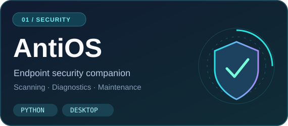
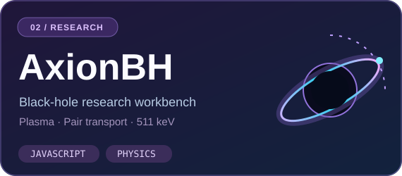
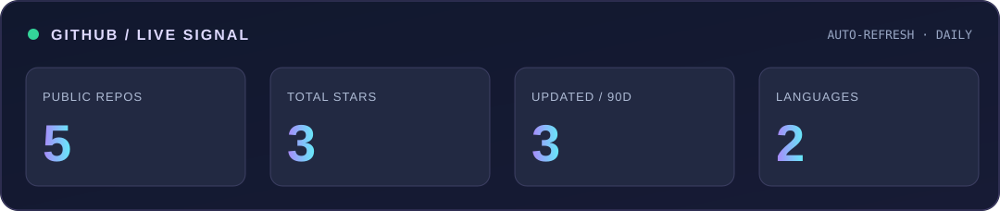

&nbsp;

&nbsp;

### `> whoami`

I'm **Dargon Tsu / DargonITP** — a cybersecurity student, software engineer and independent researcher. I build security utilities, explore systems and hardware, and turn ambitious ideas into testable software.

### `> projects --featured`

**[AntiOS](https://github.com/Dargon777/AntiOS)** — A pre-release endpoint-security companion and system-maintenance toolkit. Windows-first, with supplemental Linux support and compatibility with existing antivirus software.

**[AxionBH](https://github.com/Dargon777/AxionBH-v3.3)** — A browser-based black-hole and plasma modeling workbench exploring positron transport and Galactic 511-keV observations. **Exploratory research, not a validated astrophysical explanation.**

### `> github --pulse`

### `> contributions --animate`

<picture>
<source media="(prefers-color-scheme: dark)" srcset="./assets/snake-dark.svg" />
<source media="(prefers-color-scheme: light)" srcset="./assets/snake-light.svg" />

</picture>

### `> cat interests.txt`

`Cybersecurity` · `Python` · `JavaScript` · `Systems` · `Hardware` · `Scientific Computing` · `UI/UX`

---

**BUILD · BREAK · UNDERSTAND · IMPROVE**

Custom visuals. Live public stats and contribution animations refreshed daily with <a href="./.github/workflows/profile.yml">GitHub Actions</a>.

